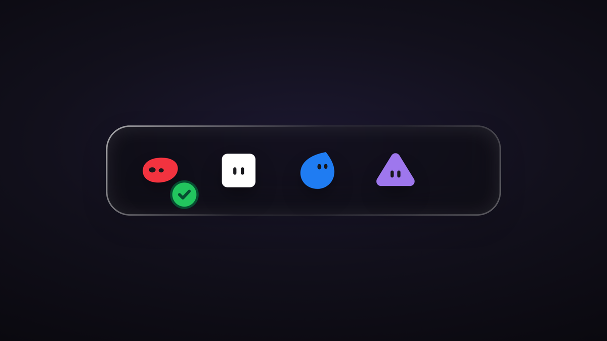

# Agent Presence



A calm, near-invisible overlay that shows what your AI agents are doing — working, waiting for you, finished, or in trouble — without taking over the screen.

This is a product I designed and directed as a senior product designer. The interface, motion, and interaction design are mine. The code was written with AI coding agents (Cursor and others) under that direction. It is an AI-built prototype, not a hand-written production codebase.

**Live demo:** _Coming soon — will be added here after deploy, expected at `https://agent-presence.vercel.app/`_

The link to try it live is the web overlay at `/` (this page). Style Lab is at `/lab/`. `/desktop/` is the transparent shell used by the native Windows app; in a plain browser it shows a preview on a dark backdrop instead of crashing or rendering a blank transparent page.

## Interactions

- **States.** Each bot can be idle, working, needs you, done, or in error. Working is carried by glancing, blinking eyes. Done plays a check and a brief confetti burst, then settles back to idle. Needs-you uses an amber pulse and a tonal badge.
- **Handoff.** A message bubble arcs from one bot to another when work is passed along.
- **Hover a bot.** The avatar highlights, lifts 2px, and scales to 1.04×, all with transforms inside a reserved 44px slot, so neighbors never shift. The close control’s 40px space is reserved even at rest.
- **Details.** Click or press Enter on a bot to open a details popover (a tool-call card with approve, decline, or retry). Clicking a bot does not change its state.
- **Hover the pill.** Only the × hide control is revealed. There is no drag-handle bar.
- **Cursor.** Default at rest and on hover. It becomes `grabbing` only after the pointer moves past a 4px drag threshold.
- **Drag.** Press anywhere on the pill, including a bot, and drag to move it. A short press still counts as a click. Position is saved in `localStorage` on the web demo and constrained to the viewport. Arrow keys nudge 8px; Shift+arrows nudge 48px.
- **Hide and restore.** × (or H in the desktop app) shrinks the widget to a “Show agents” chip. The chip pulses if an agent needs you or has errored. Hide, show, and move are announced to a live region.

Demo controls on the web page let you trigger states, pause, change speed, and force reduced motion. The desktop app also has tray items and shortcuts (including Ctrl+Alt+P to play a scripted sequence).

## Design decisions

- **Untitled UI baseline.** Color, type, radius, and control tokens start from the free Untitled UI React theme, with a dark translucent overlay palette on top.
- **Figma shadow specs.** Each mascot uses its own SVG morphology shadow, traced from the Figma reference: a two-layer erode / blur / offset (2px / 8px / 8px at 24% black, and 1px / 4px / 4px at 20%). Eyes stay unfiltered and unstroked so they stay sharp.
- **Tonal badges.** Status badges are a fixed 16px circle with Untitled UI 900 inks, a tonal outer ring, and no dark box-shadow. Marks are drawn on the pixel grid so icons stay crisp. Contrast for the four badge types was checked at 3:1 or better.
- **Aurora balance.** The Aurora style’s color blobs are weighted by hue so they feel even: white is deliberately least visible (0.40×), red is softened (~0.72×), blue is lifted slightly (~1.01×), and violet stays at 1.0×. The effect is clipped to the pill.

## Accessibility

`npm run a11y` runs axe-core plus scripted behaviour checks.

- **17 scenes, 0 axe violations.**
- **84 of 84 behaviour checks passed,** including keyboard focus and tooltips, Enter to open the details popover, Escape to close it, status in `aria-label`s, live-region announcements for approve / hide / move, the restore chip taking focus, and `prefers-reduced-motion` (instant or opacity-only motion, no looping eye or pulse animation).

## Tech stack

- [Next.js](https://nextjs.org/) 15.5 (App Router, static export)
- [React](https://react.dev/) 19
- [Tailwind CSS](https://tailwindcss.com/) v4
- [Radix UI](https://www.radix-ui.com/) (tooltip, popover, dialog)
- [Motion](https://motion.dev/)
- [Tauri](https://v2.tauri.app/) v2 for the optional Windows desktop wrapper (transparent always-on-top window, tray, global shortcuts, click-through hit regions)

## Run the web demo

```bash
npm install
npm run build
npm start
```

Then open [http://localhost:3000/](http://localhost:3000/). Style Lab is at `/lab/`. Query params on the web demo: `?scene=states`, `?scene=idle`, `?rm=1`.

## Run the desktop app

You need Rust (Cargo on your `PATH`) and the project dependencies above. From the repo root:

```bash
npm install
npx tauri dev
```

Or build a Windows executable with `npx tauri build`, then launch `src-tauri/target/release/agent-presence.exe`, or use `Launch-Desktop.cmd` on Windows. The native app loads `/desktop/`. Global shortcuts and the tray menu work there; they are not part of the browser demo.

